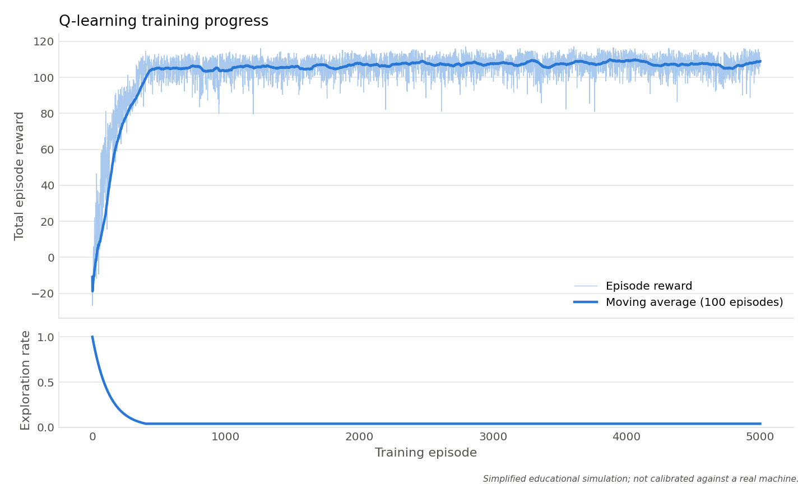
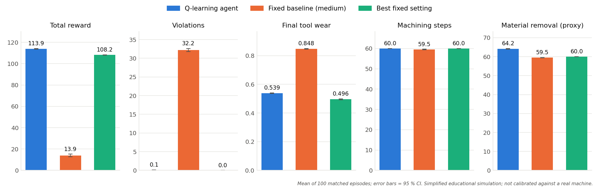

# Adaptive CNC Machining Parameter Optimization Using Reinforcement Learning

**Project report**

> All results in this report come from a simplified simulation written for this project. The equations and
> limits are illustrative. They are not calibrated against a real CNC machine, tool or workpiece, and the
> controller must not be used on real machinery.

## Abstract

CNC machining parameters are usually fixed before cutting begins, although process conditions change as the
tool wears. This project investigates whether a reinforcement learning agent can learn to adapt spindle speed,
feed rate and depth of cut in a simulated milling process. A tabular Q-learning agent with 45 states and 27
actions was trained for 5000 episodes and tested on 100 unseen episodes against two fixed-parameter controllers
under identical conditions. The agent earned a mean reward of 113.9, against 13.9 for a medium fixed setting and
108.2 for the best fixed setting. Against the best fixed setting, the paired gain was +5.75 ± 0.27 in reward and
+4.19 ± 0.14 in material removed, at the cost of slightly more tool wear (+0.043) and an occasional limit
violation (0.07 per episode). The agent learned to use a higher feed while the tool is new and to return to the
best fixed setting as the tool wears. These results show the reinforcement learning workflow on a simplified model; they
do not predict performance on a real machine.

## 1. Introduction

A milling operation is governed by parameters such as spindle speed, feed rate and depth of cut. Higher feed and
depth remove material faster, but they also increase cutting forces, vibration, heat and tool wear. Choosing
parameters is therefore a trade-off between productivity and process safety.

Reinforcement learning (RL) lets a software agent learn a decision policy by trial and error, guided by a reward
signal. It suits this trade-off because the reward can combine several goals, and the agent can react to the
current condition of the process. Training on real machines would be slow, costly and risky, so this project
uses a simulation.

## 2. Problem statement

A fixed machining program cannot respond to a tool that wears during cutting. A setting chosen for a new tool may
waste productivity, or it may break a process limit later in the tool's life. The problem is to choose machining
parameters step by step, so that material removal is maximised while vibration, temperature and tool wear stay
within limits.

## 3. Objectives

1. Build a simple simulation of a milling process with tool wear, vibration and temperature.
2. Train a tabular Q-learning agent to choose spindle speed, feed rate and depth of cut.
3. Design a reward that balances productivity against wear and limit violations.
4. Compare the agent fairly with fixed-parameter machining on identical test episodes.
5. Present the work through an interactive dashboard, with reproducible results.

## 4. Existing system and proposed system

**Existing approach (as represented here).** Parameters are selected in advance from experience or handbooks and
held constant for the whole operation. This is simple and predictable, but it does not respond to changing conditions.

**Proposed system.** A Q-learning agent observes the discretised process condition at every step and selects the
next parameter combination. It learns from simulated experience and needs no explicit rule for each situation.

## 5. System architecture

```
                  action: spindle speed, feed rate, depth of cut
             +---------------------------------------------------+
             |                                                   v
   +--------------------+                            +------------------------+
   | Q-learning agent   |                            | CNC milling simulation |
   | Q-table 45 x 27    |                            | wear, vibration,       |
   | epsilon-greedy     |                            | temperature, limits    |
   +--------------------+                            +------------------------+
             ^                                                   |
             +---------------------------------------------------+
                         state (45 bins) and reward

   cnc_rl_demo.py: simulation, agent, training, evaluation, output files
   app.py: Streamlit dashboard          results/: CSV files, charts, summary
```

| File | Purpose |
|---|---|
| `cnc_rl_demo.py` | simulator, Q-learning agent, training, evaluation, saved outputs |
| `app.py` | interactive Streamlit dashboard |
| `tests/` | automated checks of the simulator, the Q-learning update, the evaluation and the dashboard |
| `results/` | training history, evaluation data, charts and the experiment summary |

## 6. Methodology

1. Define the simulation, its limits, and the state, action and reward.
2. Train the agent over repeated episodes with ε-greedy exploration.
3. Select the best fixed setting and the training length on separate tuning seeds (5000 to 5049).
4. Freeze the agent (no exploration, no learning) and test all controllers on seeds 1000 to 1099.
5. Compare the controllers using paired differences with 95 % confidence intervals.
6. Repeat training with five seeds, to check that the result does not depend on one training run.

## 7. CNC simulation model

One episode represents one tool cutting for up to 60 steps. The episode ends early if the tool reaches its wear
limit. With sr, fr and dr as spindle speed, feed and depth relative to the medium setting (4500 rpm, 160 mm/min,
0.8 mm), and w as tool wear at the start of the step:

```
vibration   = 0.20 + 0.20 sr + 0.22 fr + 0.28 dr + 0.18 [dr-1]+ [fr-1]+ + 0.25 w + noise (±0.035)
temperature = 42 + 17 sr + 13 fr + 15 dr + 20 w + noise (±1.5)
wear added  = 0.012 sr^1.35 fr^1.15 dr^1.20 (1 + 0.45 [vibration-0.75]+)
productivity (material removal proxy) = feed x depth / (160 x 0.8)
```

Here [x]+ means x when positive and 0 otherwise. A worn tool vibrates more and runs hotter, so a setting that is
safe for a new tool may not stay safe.

| Limit | Value | Effect |
|---|---|---|
| Vibration index | 1.0 | violation, reward penalty |
| Cutting temperature | 105 °C | violation, reward penalty |
| Tool wear | 0.85 | violation, reward penalty, episode ends |

These equations are illustrative trends, not fitted to measurements.

## 8. Q-learning algorithm

Q-learning (Watkins and Dayan, 1992) stores an estimate Q(s, a) of the long-term reward of taking action a in
state s. After each step the estimate is updated:

```
Q(s,a) <- Q(s,a) + alpha [ r + gamma max_a' Q(s',a') - Q(s,a) ]
```

| Setting | Value | Meaning |
|---|---|---|
| Learning rate α | 0.15 | how far each update moves the estimate |
| Discount factor γ | 0.92 | weight of future reward |
| Initial exploration ε | 1.0 | all actions random at the start |
| ε decay | 0.992 per episode | exploration falls gradually |
| Minimum ε | 0.04 | reached after about 400 episodes |
| Training episodes | 5000 | about 2 seconds on a laptop |

When the tool fails, the future term is dropped, because the episode truly ends. Reaching the 60-step limit is not
treated as an ending of the process, so the update still includes the future term.

## 9. State space

The continuous measurements are grouped into 5 × 3 × 3 = **45 states**.

| Variable | Bins |
|---|---|
| Tool wear | 0.0-0.2, 0.2-0.4, 0.4-0.6, 0.6-0.8, 0.8+ |
| Vibration | normal (< 0.85), elevated (0.85 to 1.0), over limit (> 1.0) |
| Temperature | normal (< 90), elevated (90 to 105), over limit (> 105) |

## 10. Action space

An action is one combination of three levels of each parameter, so there are 3 × 3 × 3 = **27 actions**.

| Parameter | Levels |
|---|---|
| Spindle speed (rpm) | 3000, 4500, 6000 |
| Feed rate (mm/min) | 100, 160, 220 |
| Depth of cut (mm) | 0.5, 0.8, 1.1 |

## 11. Reward function

```
reward = 2 x productivity
         - 22.5 x wear added
         - 7 x [vibration - 0.85]+^2
         - 0.025 x [temperature - 90]+
         - 2.0 if vibration is over its limit
         - 1.5 if temperature is over its limit
         - 3.0 if the wear limit is reached
```

The reward pays for material removed. Graded penalties begin before the limits, which gives the agent a warning
signal, and fixed penalties apply when a limit is broken. Tool failure also costs all the reward of the remaining
steps. The weights are design choices, not engineering constants.

## 12. Experimental setup

| Item | Setting |
|---|---|
| Training | 5000 episodes, seed 7 |
| Test | 100 episodes, seeds 1000 to 1099, not used in training |
| Matched conditions | same seed for each controller, so the same starting state and noise sequence |
| Agent during test | greedy, no exploration, no learning |
| Fixed baseline (medium) | 4500 rpm, 160 mm/min, 0.8 mm |
| Best fixed setting | 3000 rpm, 160 mm/min, 0.8 mm: the best of all 27 constant settings on tuning seeds 5000 to 5049 |
| Seed study | training seeds 7, 11, 23, 42, 101 |
| Statistics | paired differences with a 95 % confidence interval |

The best fixed setting was added because comparing only with an arbitrary setting would flatter the agent.

### Review of the first version

The first version of the code ran correctly, but testing it showed that its comparison was misleading. These
problems were fixed before the results below were produced. The original file is in `original_backup/`.

| Finding in the first version | Evidence | Correction |
|---|---|---|
| The fixed baseline sat exactly on the vibration limit | mean vibration 1.00, limit 1.00; 29.66 violating steps out of 60 | vibration base value lowered, so the medium setting is safe for a new tool |
| The temperature and wear limits could not be reached | maximum temperature 104.7 °C (limit 105), maximum wear 0.43 (limit 0.85) over 3000 test episodes | wear rate raised from 0.0015 to 0.012, and the wear penalty rescaled so its reward cost is unchanged; wear now raises vibration and temperature |
| Only 7 of 45 states could be reached, and all episodes lasted 60 steps | measured | as above; 29 states are now visited in training |
| The headline result flattered the agent | reward 102.4 against 33.1 for the medium baseline, but a constant 3000 rpm, 160 mm/min, 0.8 mm setting earned 106.8 and beat the agent | best fixed setting added as a second baseline |
| Reaching the step limit was treated as a real ending | code inspection | only tool failure now ends the future term |
| The state bins did not match the limits | temperature bin edge 110, limit 105 | bin edges aligned with the soft levels and limits |
| The comparison chart normalised unlike metrics onto one axis | code inspection | one panel per metric, in its own units |

The new simulator constants were chosen from reachability reasoning, before the agent was evaluated on the test seeds.

## 13. Results

### 13.1 Training



Reward rose quickly during the first 400 episodes, while exploration fell. It then levelled off, with a final
100-episode moving average of 109.0 at ε = 0.04. The agent visited 29 of the 45 states. This shows that the reward
stopped improving noticeably; it does not prove that the optimal policy was found.

### 13.2 Test comparison (mean over 100 matched episodes)

| Metric | Q-learning agent | Fixed baseline (medium) | Best fixed setting |
|---|---|---|---|
| Total reward | 113.914 | 13.908 | 108.163 |
| Machining steps | 60.000 | 59.480 | 60.000 |
| Violating steps | 0.070 | 32.190 | 0.000 |
| Final tool wear | 0.539 | 0.848 | 0.496 |
| Material removal proxy | 64.186 | 59.480 | 60.000 |
| Tool-failure rate | 0.000 | 0.560 | 0.000 |



### 13.3 Paired differences (Q-learning minus the other controller, 95 % CI)

| Metric | Against medium baseline | Against best fixed setting |
|---|---|---|
| Total reward | +100.006 ± 1.066 | +5.751 ± 0.271 |
| Violating steps | -32.120 ± 0.424 | +0.070 ± 0.051 |
| Final tool wear | -0.309 ± 0.001 | +0.043 ± 0.001 |
| Material removal proxy | +4.706 ± 0.128 | +4.186 ± 0.143 |
| Tool-failure rate | -0.560 ± 0.099 | 0 |

### 13.4 Training-seed study

| Training seed | Reward | Violating steps | Reward minus best fixed |
|---|---|---|---|
| 7 | 113.91 | 0.07 | +5.75 |
| 11 | 114.53 | 0.08 | +6.37 |
| 23 | 114.90 | 0.08 | +6.73 |
| 42 | 115.34 | 0.11 | +7.17 |
| 101 | 112.29 | 0.01 | +4.13 |

### 13.5 What the agent learned

| Tool wear | Most-used setting in testing | Share of steps in that wear range | Mean productivity |
|---|---|---|---|
| 0.0 to 0.2 | 3000 rpm, 220 mm/min, 0.8 mm | 81 % | 1.29 |
| 0.2 to 0.4 | 3000 rpm, 160 mm/min, 0.8 mm | 96 % | 0.99 |
| 0.4 to 0.6 | 3000 rpm, 160 mm/min, 0.8 mm | 100 % | 1.00 |

## 14. Discussion

**The large gain over the medium baseline says little on its own.** The medium setting is safe for a new tool, but
its vibration passes the limit once wear reaches about 0.4, and it hits the wear limit in 56 % of episodes. A
person tuning the process would not choose it. It shows the cost of a poorly chosen fixed program.

**The comparison with the best fixed setting is the meaningful one.** The agent's gain is real but modest: about
5 % more reward and 7 % more material removed. The gain held for all five training seeds (+4.13 to +7.17). It has a cost: tool
wear rises by 0.043 and limit violations appear, although rarely.

**The behaviour is adaptive and has a clear explanation.** While the tool is new, there is spare vibration margin, so the
agent uses a higher feed. As wear grows and vibration rises, it returns to the best fixed setting. A fixed
program cannot do this.

**The spindle choice is a model artefact.** The agent stays at 3000 rpm almost all the time, because in this model
spindle speed adds wear, vibration and heat but does not increase material removal. Real milling couples spindle
speed and feed through the feed per tooth, so this behaviour should not be read as machining advice.

## 15. Limitations

- The model is simplified and not calibrated; absolute values have no physical meaning.
- Spindle speed does not affect productivity, and chip load (feed per tooth) is not modelled.
- Each step uses discrete settings, and parameter changes between steps are instantaneous.
- Chatter is represented only by a smooth vibration index, not by stability lobes.
- Coarse bins hide detail, and the state has no information about elapsed time.
- 16 of the 45 states were not visited in training; their Q-values stay at zero.
- Only two kinds of fixed controller were compared. There is no comparison with a rule-based adaptive controller.
- The best fixed setting and the training length were chosen on tuning seeds, while simulator constants were set by
  reasoning about the model; results could change with other constants.

## 16. Conclusion

A tabular Q-learning agent learned, within the simulation, to adapt machining parameters to tool wear. It clearly
outperformed a poorly chosen fixed setting and modestly outperformed the best fixed setting, on identical
test episodes and across five training seeds. The project also shows why a fair baseline matters: the
first version's large apparent gain disappeared when the best fixed setting was tested. The work demonstrates the
reinforcement learning workflow and its evaluation, not readiness for a real machine.

## 17. Future scope

- Calibrate the model with cutting-force, tool-wear and vibration measurements.
- Add feed per tooth and a more realistic chatter model.
- Compare with a rule-based adaptive controller.
- Use finer states or function approximation, such as deep Q-networks.
- Add disturbances such as changes in material hardness.
- Before any real use, test in shadow mode, with independent machine-level safety limits.

## References

1. C. J. C. H. Watkins and P. Dayan, "Q-learning," *Machine Learning*, vol. 8, pp. 279-292, 1992.
2. R. S. Sutton and A. G. Barto, *Reinforcement Learning: An Introduction*, 2nd ed., MIT Press, 2018.

The simulator's equations are illustrative and were not taken from a published source.
